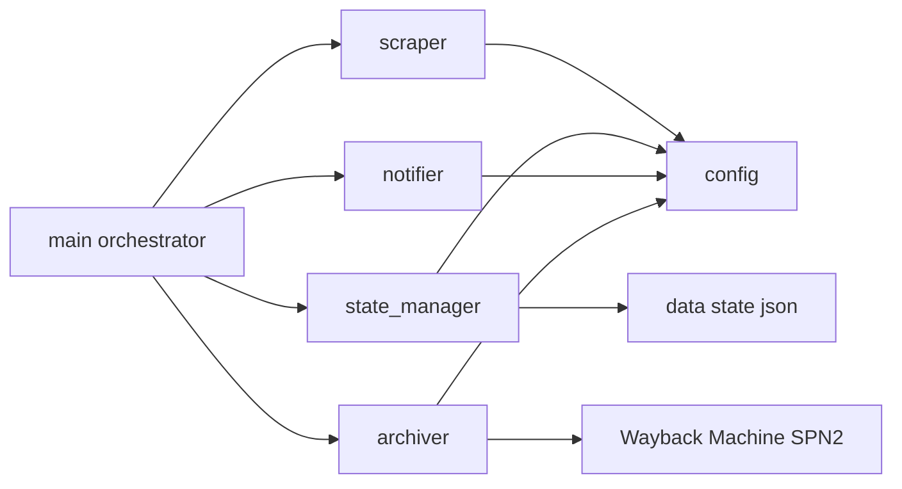
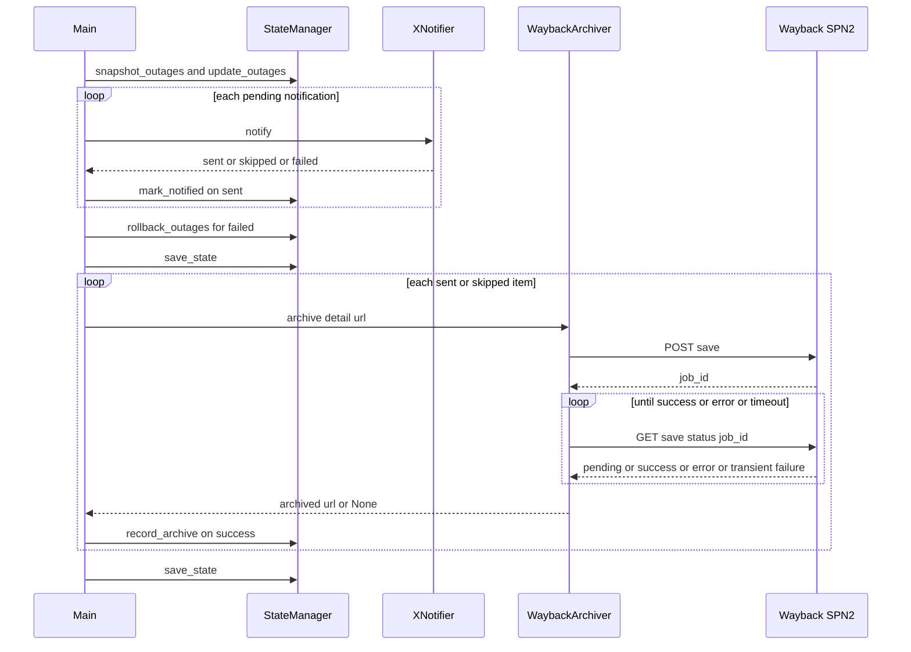

# 技術設計書: outage-page-archive

## Overview

**Purpose**: 本機能は、障害の新規検出時と各ステータス変更の検出時に、その障害の詳細ページを Wayback Machine（Internet Archive）に保存し、魚拓の公開 URL を状態ファイルに記録する。運用者は、公式ページが後から書き換えられたり削除されたりしても、通知時点の内容を第三者のアーカイブで参照できる。

**Users**: 運用者が、障害ごと・ステータスごとの魚拓 URL を `data/state.json` から参照する。通知の受け手（X のフォロワー）に見える挙動は変わらない。

**Impact**: 既存の「スクレイピング → 差分検知 → 通知 → 状態保存」パイプラインの「通知」と「状態保存」の間に、ベストエフォートの「魚拓取得」段階を追加する。新モジュール `src/archiver.py` を追加し、`state_manager.py` に記録用メソッドと `archives` キーを追加し、`main.py` が通知ループ後に archiver を呼ぶ。終了コードの契約、通知判定、巻き戻しの流れは変えない。

### Goals
- 新規検出・ステータス変更の各時点で詳細ページの魚拓を取り、`archives` 配列に `{status, archived_at, url}` を追記する（1.1–1.6, 2.1–2.6）
- 魚拓の失敗を通知・状態保存・終了コードから完全に隔離する（3.1–3.6）
- 認証情報を既存のシークレットと同じ方法で注入し、未設定時と DRY RUN 時は安全に無効化する（4.1–4.4）
- README・`.env.example`・ワークフロー・運用標準を更新し、既存のテストと Ruff を通す（5.1–5.4）

### Non-Goals
- 魚拓 URL をツイート本文に載せること
- 一覧ページの魚拓、導入前の障害の遡及取得
- 失敗した魚拓の再試行、保留中ジョブの持ち越し
- Wayback Machine 以外のサービスへのフォールバック、自前の HTML 保存
- 複数件の並列投入（`job_ids=` 一括問い合わせ）。件数が増えたときの改善案として `research.md` に記録

## Boundary Commitments

### This Spec Owns
- `src/archiver.py`: Wayback Machine SPN2 への保存要求と完了確認、公開 URL の組み立て、無効化（認証情報なし・DRY RUN）の判定
- `data/state.json` の障害エントリ内 `archives` 配列の形式と、`StateManager.record_archive()` による追記
- `main.py` における魚拓取得の呼び出し位置（通知ループ後）と対象の選定（`"sent"` / `"skipped"` のみ）、例外の隔離、件数サマリのログ
- `config.py` の Wayback 関連定数と認証情報の取得関数
- ワークフローのシークレット注入、`.env.example`、README、`.kiro/steering/operations.md` の該当箇所

### Out of Boundary
- 通知の判定・投稿・通知済みマーク・月間カウンタ・巻き戻し（`_process_notification()` と `rollback_outages()` の挙動）
- 終了コードの契約（`EXIT_*` と `check-outage.yml` の分岐）。魚拓の結果は終了コードに影響しない
- ツイート本文の整形（`notifier.py`）
- 状態ファイルのコミット・push・JSON 検証（既存ワークフローがそのまま担う）
- スクレイパー（詳細ページを本システムが取得することはない。取得するのは Wayback Machine 側）

### Allowed Dependencies
- `archiver.py` → `config.py`（定数・認証情報）と `requests`（既存依存）。`state_manager.py` / `notifier.py` / `scraper.py` に依存しない
- `main.py` → `archiver.py`（既存の `main → 各モジュール → config` の一方向を維持）
- `state_manager.py` は `archiver.py` を import しない（記録の値は main が渡す）
- 新しいサードパーティ依存は追加しない（`uv.lock` の変更なし）

### Revalidation Triggers
- `archives` 要素のキー名・形式を変える場合（README と旧スキーマ読み込みの再確認）
- 魚拓を通知の前に動かす、または魚拓 URL をツイートに載せる場合（通知の遅延と文字数の再検証）
- 魚拓の失敗を終了コードに反映する場合（`main.py`・`check-outage.yml`・README の 3 箇所同時更新が必要。tech.md の終了コード契約）
- `update_outages()` が追加キーを保持しなくなる変更（`archives` が消える）

## Architecture

### Existing Architecture Analysis
- **パターン**: 単一プロセスのバッチ型パイプライン。`main.py` が各段階を順に呼ぶオーケストレーター
- **保持する依存方向**: `main` → `scraper` / `state_manager` / `notifier` / `archiver` → `config`
- **保持するドメイン境界**: HTTP の副作用は専用モジュールに閉じる。Wayback への HTTP は `archiver.py` に閉じ、状態の書き込みは `state_manager.py` のメソッド経由に限る
- **活用する既存の仕組み**: `_PendingNotification` による通知単位の統一、`"sent" | "skipped" | "failed"` の 3 値、`DRY_RUN` の import 時評価、`get_x_credentials()` 型の認証情報関数、`HEALTHCHECKS_URL` 未設定時のスキップという任意機能の流儀

### Architecture Pattern & Boundary Map



**Architecture Integration**:
- Selected pattern: 既存のレイヤード・バッチパイプラインに「魚拓取得」段階を 1 つ追加する。新パターンは導入しない
- Domain boundaries: `archiver` は「URL を渡すと魚拓 URL か None を返す」だけの副作用モジュール。何を・いつ取るかは `main` が決め、どう記録するかは `state_manager` が決める
- Existing patterns preserved: 設定の一元化、副作用の分離、状態は state_manager 経由、終了コードは main とワークフローだけが知る
- New components rationale: `archiver.py` は外部サービスとの HTTP 契約（認証・ポーリング・エラー分類）を 1 箇所に閉じ、テストでモック可能にするために必要
- Steering compliance: 認証情報は環境変数のみ、ログ・コメントは日本語、`@dataclass` と `_` プレフィックス、順序依存はコメントで明示

### Technology Stack

| Layer | Choice / Version | Role in Feature | Notes |
|-------|------------------|-----------------|-------|
| Backend / Services | Python 3.14、`requests`（既存） | SPN2 への POST / GET、JSON 解析 | 新規依存なし |
| External Service | Wayback Machine SPN2 API（`https://web.archive.org/save`） | 詳細ページのキャプチャと公開 | 認証は S3 キー（`Authorization: LOW key:secret`）。契約の詳細は `research.md` |
| Data / Storage | `data/state.json`（スキーマ `1.2`） | 魚拓記録の永続化 | 障害エントリに `archives` 配列を追加。旧形式はそのまま読む |
| Infrastructure / Runtime | GitHub Actions（`check-outage.yml`） | シークレット `WAYBACK_ACCESS_KEY` / `WAYBACK_SECRET_KEY` の注入 | 未設定でもジョブは動く |
| Testing | pytest / `responses` / `pytest-mock`（既存） | SPN2 応答のモック、`sleep` と経過時間のモック | 実要求は `responses` が遮断する |

## File Structure Plan

### Directory Structure
```
src/
├── archiver.py          # 新規: Wayback Machine SPN2 への保存要求・完了確認・無効化判定
├── config.py            # Wayback の URL・待ち時間の定数、認証情報の取得関数を追加
├── state_manager.py     # SCHEMA_VERSION 1.2、archives の初期化と record_archive() を追加
└── main.py              # 通知ループ後に魚拓取得を呼ぶ。_PendingNotification に url を追加
tests/
├── test_archiver.py     # 新規: WaybackArchiver のテスト（responses で SPN2 をモック）
├── test_state_manager.py# record_archive と旧スキーマ読み込みのテストを追加
├── test_main.py         # 魚拓取得の呼び出し位置・対象・例外隔離のテストを追加
└── conftest.py          # Wayback 認証情報を既定で空にする autouse fixture を追加
.github/workflows/check-outage.yml  # Run outage checker に WAYBACK_* シークレットを env 追加
.env.example             # WAYBACK_ACCESS_KEY / WAYBACK_SECRET_KEY のコメントアウトしたプレースホルダ
README.md                # 認証情報の取得・設定手順、記録の場所と形式
CLAUDE.md                # 魚拓取得の仕様（契機・対象・失敗時・DRY RUN）を追記
.kiro/steering/operations.md  # シークレット一覧に Wayback キーを追加
.kiro/steering/tech.md        # 重要な技術的判断に「魚拓はベストエフォート」を追記
```

### New Files
- `src/archiver.py` — `WaybackArchiver` クラス。認証情報の有無と `DRY_RUN` による無効化、`archive(url) -> str | None`、内部の `_submit()` / `_wait_for_capture()`、公開 URL の組み立て。Wayback への HTTP はこのファイルにのみ存在する（1.6, 3.1, 3.3, 4.2, 4.3, 4.4）
- `tests/test_archiver.py` — `TestWaybackArchiver` 系のテストクラス（成功、`error` 応答、`pending` のまま時間切れ、HTTP エラー、`job_id` なし応答、認証情報なし、DRY RUN）

### Modified Files
- `src/config.py` — `WAYBACK_SAVE_URL`、`WAYBACK_POLL_INTERVAL`（5 秒）、`WAYBACK_TIMEOUT`（120 秒）、`WAYBACK_IF_NOT_ARCHIVED_WITHIN`（60 秒）、`WAYBACK_RUN_BUDGET`（300 秒）、`WAYBACK_SUBMIT_RETRY_WAIT`（5 秒）、`get_wayback_credentials()` を追加（4.1）。一時的な応答コードの区分 `TRANSIENT_CLIENT_ERRORS` / `is_transient_status()` は scraper から移して archiver と共有する
- `src/state_manager.py` — `SCHEMA_VERSION = "1.2"`、`update_outages()` の新規エントリに `"archives": []`、`record_archive(outage_id, status, archived_url)` を追加。`_load_state()` は旧形式をそのまま読み、`schema_version` が現行より旧いときだけメモリ上で現行値にする（新しい版数は残す。dirty にしない）（2.1, 2.2, 2.5, 2.6）
- `src/main.py` — `_PendingNotification` に `url` フィールドを追加。通知ループの結果を保持し、ループ後に `_archive_outages()` で `"sent"` / `"skipped"` の件を順に処理する。archiver の生成と呼び出しを `try/except Exception` で包む。件数サマリのログ（1.1–1.5, 3.2, 3.5, 3.6）
- `tests/test_state_manager.py` — `schema_version == "1.1"` の期待値を `"1.2"` に更新。`TestRecordArchive` と旧スキーマ読み込みのテストを追加
- `tests/test_main.py` — `src.main.WaybackArchiver` をパッチし、呼び出し順序（全通知の後）、対象（failed を除く）、例外隔離（終了コード不変）、認証情報なし時の警告を検証
- `tests/conftest.py` — autouse fixture `no_wayback_credentials` で `WAYBACK_ACCESS_KEY` / `WAYBACK_SECRET_KEY` を削除し、ローカルの `.env` に本物のキーがあってもテストから保存要求が出ないようにする（`never_post_for_real` と同じ目的）
- `.github/workflows/check-outage.yml` — `Run outage checker` ステップの `env` に `WAYBACK_ACCESS_KEY: ${{ secrets.WAYBACK_ACCESS_KEY }}` と `WAYBACK_SECRET_KEY: ${{ secrets.WAYBACK_SECRET_KEY }}` を追加（5.2）
- `.env.example` — 2 つのキーを**コメントアウトした行**で追加（`HEALTHCHECKS_API_KEY` と同じ流儀）。X API のようにプレースホルダ値を有効な行で置くと、コピーしただけで archiver が有効になり 401 になる要求を毎回送るため（5.2）
- `README.md` — 環境変数の表、シークレット一覧、魚拓の節（取得手順、記録場所、ベストエフォートであること）（5.1）
- `CLAUDE.md` — 「実装上の重要なポイント」に魚拓取得の節を追加
- `.kiro/steering/operations.md` — シークレット表に Wayback キー（期限なし、未設定なら機能スキップ）を追加（5.3）
- `.kiro/steering/tech.md` — 重要な技術的判断に 1 項目追加

## System Flows

通知ループと魚拓取得の順序、および失敗の隔離:



- **順序の決定**: 魚拓は全通知の後。ツイートを魚拓の待ち時間（最大 120 秒/件）で遅らせない。巻き戻しの直後に一度 `save_state()` してから魚拓に入り、魚拓中にプロセスが落ちても投稿済みのマークとカウンタを失わないようにする。魚拓の後の `save_state()` は記録が無ければ dirty でないので書き込まない。`"failed"` の件は魚拓の対象に含めないので、記録が巻き戻しで消えることはない
- **ゲーティング**: `main` は対象が 0 件なら archiver を生成せず、DRY RUN なら archiver を生成せずに対象 URL をログに出して終える（認証情報の有無より先に判定する）。`archive()` 自身は先頭で「無効（認証情報なし）」だけを判定して None を返し、DRY RUN は知らない（判定を main に集約する）。無効時の警告は archiver 生成時に 1 回だけ出す
- **時間上限**: `archive()` の開始から `WAYBACK_TIMEOUT` 秒（`main` から実行全体の期限 `deadline` が渡されればその早い方）を deadline とし、保存要求の再試行も完了確認もこの deadline の中で行う。`WAYBACK_POLL_INTERVAL` 秒ごとにステータスを問い合わせ、問い合わせ自体の通信エラー・5xx・408/429・非 JSON は一時的な失敗として deadline まで問い合わせを続ける（ジョブは Wayback 側で動き続けているため）。それ以外の 4xx（401/403/404）は再試行しても変わらないので即座に失敗にし、HTTP ステータスを警告に出す。deadline 超過は失敗（None、WARNING「時間切れ」）。各 HTTP 要求のタイムアウトは `REQUEST_TIMEOUT` と deadline までの残り時間の小さい方にし、deadline を超えてブロックしない
- **保存要求の再試行**: POST の 5xx・408/429・通信エラー・非 JSON は `WAYBACK_SUBMIT_RETRY_WAIT` 秒後に 1 回だけ再試行する（SPN2 は過負荷時に 503 や HTML を返す）。それ以外の 4xx と `job_id` なしの応答は再試行しない
- **実行全体の時間予算**: `main` は魚拓フェーズの開始から `WAYBACK_RUN_BUDGET` 秒を超えたら残りの件を失敗として数えて諦める。対象が多い実行（状態ファイルの作り直し直後など）で実行時間が数十分に延び、Healthchecks の猶予を超えて誤報になるのを防ぐ。通知済みの状態は魚拓の前に保存済みなので通知には影響しない

## Requirements Traceability

| Requirement | Summary | Components | Interfaces | Flows |
|-------------|---------|------------|------------|-------|
| 1.1 | 新規検出の送信/スキップ後に魚拓 | main `_archive_outages` | `WaybackArchiver.archive` | 通知ループ後 |
| 1.2 | ステータス変更ごとに魚拓 | main `_archive_outages` | `record_archive(status=new_status)` | 同上 |
| 1.3 | スキップ時も魚拓 | main（対象選定） | 結果 `"skipped"` を対象に含める | 同上 |
| 1.4 | 失敗した変更は魚拓しない | main（対象選定） | 結果 `"failed"` を除外 | 巻き戻しの前後に依存しない |
| 1.5 | 全通知の後に開始 | main | ループを分離 | シーケンス図 |
| 1.6 | 対象は詳細 URL のみ | main `_PendingNotification.url` | `OutageInfo.url` をそのまま渡す | — |
| 2.1 | status / archived_at / url を 1 件追加 | StateManager | `record_archive` | — |
| 2.2 | 既存記録を保持して追記 | StateManager | `setdefault("archives", []).append` | — |
| 2.3 | 状態ファイルに保存しコミット | StateManager / 既存ワークフロー | `save_state` | — |
| 2.4 | 通知本文に含めない | notifier 無変更 | — | — |
| 2.5 | 旧スキーマをそのまま読む | StateManager `_load_state`（無変更） | `archives` 欠落を許容 | — |
| 2.6 | 更新時に記録を保持 | StateManager `update_outages` | 追跡フィールドのみ上書き | — |
| 3.1 | 失敗は警告のみ、記録なし | WaybackArchiver | `archive -> None` + WARNING | — |
| 3.2 | 通知判定・マーク・カウンタ・終了コード不変 | main | archiver の戻り値を終了コードに使わない | — |
| 3.3 | 1 件の時間上限 | WaybackArchiver `_wait_for_capture` | `WAYBACK_TIMEOUT` | ポーリング |
| 3.4 | 再試行しない | main / StateManager | 未取得を状態に残さない | — |
| 3.5 | 予期しない例外を隔離 | main `_archive_outages` | `try/except Exception` | — |
| 3.6 | 件数サマリのログ | main | INFO / WARNING | — |
| 4.1 | 環境変数から認証情報 | config `get_wayback_credentials` | — | — |
| 4.2 | 未設定なら取得せず警告 1 回 | WaybackArchiver `enabled` | 生成時 WARNING | — |
| 4.3 | DRY RUN は要求を送らずログ | WaybackArchiver | `DRY_RUN` 判定 | — |
| 4.4 | 認証情報を出力しない | WaybackArchiver | ヘッダはセッションに設定、ログに含めない | — |
| 5.1 | README | docs | — | — |
| 5.2 | `.env.example` / ワークフロー | docs / workflow | — | — |
| 5.3 | operations.md | docs | — | — |
| 5.4 | テストと Ruff | tests | — | — |

## Components and Interfaces

| Component | Domain/Layer | Intent | Req Coverage | Key Dependencies (P0/P1) | Contracts |
|-----------|--------------|--------|--------------|--------------------------|-----------|
| WaybackArchiver | 外部連携（archiver.py） | 詳細 URL を SPN2 で保存し公開 URL を返す | 1.6, 3.1, 3.3, 4.2, 4.3, 4.4 | config (P0), requests (P0), Wayback SPN2 (P1 external) | Service, API |
| StateManager.record_archive | 状態管理（state_manager.py） | 魚拓記録を障害エントリに追記 | 2.1, 2.2, 2.5, 2.6 | 既存 StateManager (P0) | Service, State |
| main 魚拓オーケストレーション | オーケストレーション（main.py） | 対象選定・呼び出し順序・例外隔離・サマリ | 1.1–1.5, 3.2, 3.4, 3.5, 3.6 | WaybackArchiver (P1), StateManager (P0) | Batch |
| config 追加分 | 設定（config.py） | 定数と認証情報の取得 | 4.1 | 環境変数 (P0) | Service |
| ワークフロー・ドキュメント | 運用 | シークレット注入と手順の文書化 | 5.1–5.3 | GitHub Secrets (P1) | — |

### 外部連携

#### WaybackArchiver

| Field | Detail |
|-------|--------|
| Intent | 1 つの URL を Wayback Machine に保存し、公開 URL を返す。失敗は None |
| Requirements | 1.6, 3.1, 3.3, 4.2, 4.3, 4.4 |

**Responsibilities & Constraints**
- Wayback への HTTP（保存要求・ステータス問い合わせ）はこのクラスにのみ置く
- 例外を外に投げない。`requests.RequestException`、JSON 解析失敗、想定外の応答形式はすべて WARNING ログと None に変換する
- 認証情報の値をログ・例外メッセージに含めない。`Authorization` ヘッダは `requests.Session` に設定する
- 状態（StateManager）を知らない。記録は呼び出し側の責務

**Dependencies**
- Inbound: `main._archive_outages` — 対象 URL ごとに呼ぶ（P0）
- Outbound: `config` — `WAYBACK_SAVE_URL`、`WAYBACK_POLL_INTERVAL`、`WAYBACK_TIMEOUT`、`WAYBACK_IF_NOT_ARCHIVED_WITHIN`、`WAYBACK_SUBMIT_RETRY_WAIT`、`REQUEST_TIMEOUT`、`is_transient_status()`、`get_wayback_credentials()`（P0）。`DRY_RUN` は読まない（判定は main）
- External: Wayback Machine SPN2 — 認証付き。7 件/分、同一 URL 10 件/日、1 件最大 2 分（P1）。契約の詳細は `research.md`

**Contracts**: Service [x] / API [x] / Event [ ] / Batch [ ] / State [ ]

##### Service Interface
```python
class WaybackArchiver:
    """Wayback Machine（SPN2）で URL の魚拓を取るクラス"""

    def __init__(self) -> None:
        """認証情報を読み、無ければ無効化して WARNING を 1 回出す。
        有効なら requests.Session を作り Accept と Authorization ヘッダを設定する"""

    @property
    def enabled(self) -> bool:
        """認証情報が揃っているとき True"""

    def archive(self, url: str, deadline: float | None = None) -> str | None:
        """url の魚拓を取り、公開 URL（https://web.archive.org/web/<timestamp>/<url>）を返す。
        無効時・失敗時は None。deadline（time.monotonic 基準）が渡されればそれより後には待たない"""

    def close(self) -> None: ...
    def __enter__(self) -> WaybackArchiver: ...
    def __exit__(self, *exc_info: object) -> None: ...

    def _submit(self, url: str, deadline: float) -> str | None:
        """保存要求を送り job_id を返す。一時的な失敗は deadline に収まる範囲で 1 回だけ再試行し、
        失敗なら WARNING を出して None"""

    def _wait_for_capture(self, job_id: str, deadline: float) -> str | None:
        """status が success になるまで WAYBACK_POLL_INTERVAL 秒ごとに問い合わせ、timestamp を返す。
        error なら None。deadline 超過は内部例外で archive() に伝え、時間切れの WARNING にする"""
```
- Preconditions: `url` は絶対 URL（`OutageInfo.url` は `urljoin` 済み）
- Postconditions: 戻り値が str のとき、その URL は Wayback 上で解決できる。None のとき WARNING（無効時は生成時の 1 回のみ）が出ている
- Invariants: 1 回の `archive()` の所要時間は `WAYBACK_TIMEOUT` 秒（`deadline` が渡されればそれまでの残り時間）を超えない。例外を送出しない

##### API Contract（Wayback SPN2、外部）
| Method | Endpoint | Request | Response | Errors |
|--------|----------|---------|----------|--------|
| POST | `https://web.archive.org/save` | ヘッダ `Accept: application/json`、`Authorization: LOW key:secret`。フォーム `url`, `skip_first_archive=1`, `js_behavior_timeout=0`, `if_not_archived_within=60` | `{"url": ..., "job_id": "..."}` | 401（認証不正）、429（レート制限）、`job_id` 欠落で `{"message": ...}` |
| GET | `https://web.archive.org/save/status/<job_id>` | 同じヘッダ | `{"status": "pending"}` / `{"status": "success", "timestamp": "YYYYMMDDHHMMSS", "original_url": ...}` / `{"status": "error", "status_ext": "error:...", "message": ...}` | 5xx、非 JSON |

- `if_not_archived_within=60`: 既定の 1 時間では新規検出から 1 時間以内の復旧で古いキャプチャが返るため、実行間隔（10 分）より短い値で毎回新しいキャプチャを作る
- `capture_all` は付けない。詳細ページが 404 のときは `error:not-found` で失敗にし、エラーページを記録しない
- 公開 URL は `https://web.archive.org/web/{timestamp}/{url}`（`url` は送信した詳細 URL）

**Implementation Notes**
- Integration: `main` は魚拓の対象（`"sent"` / `"skipped"`）が 1 件以上あるときだけ archiver を生成する（全件 `"failed"` の実行では生成しない）。`with` で使いセッションを閉じる
- Validation: `responses` で POST / GET をモックし、conftest の `fake_clock`（`time.monotonic` の偽の時計）と、待機した秒数だけそれを進める `no_sleep` で時間切れを再現する。`get_wayback_credentials` は `monkeypatch.setenv` で与える
- Risks: SPN2 の過負荷（`error:cannot-fetch`, `error:user-session-limit`）は失敗として扱うだけ。実行時間は 1 件最大 120 秒延びうる。保存要求が受理されたのに応答が届かず再試行した場合は同じページに 2 件目のジョブが入りうる（セッション枠を 1 つ余分に使うだけで記録は 2 件目の結果になる。許容）

### 状態管理

#### StateManager.record_archive

| Field | Detail |
|-------|--------|
| Intent | 魚拓記録を障害エントリの `archives` に追記する |
| Requirements | 2.1, 2.2, 2.5, 2.6 |

**Responsibilities & Constraints**
- `archives` 配列の形式はここだけが知る。要素は `{"status": str, "archived_at": ISO 8601 UTC, "url": str}`
- 既存要素は保持し末尾に追記する。同じ `status` が既にあっても追記する（巻き戻し後の再検出や push 失敗後の再実行で同じステータスを再取得した記録も残す）
- `mark_notified()` と同じく、state に存在しない障害は無視する
- `update_outages()` の新規エントリには `"archives": []` を含め、既存エントリの更新では追跡フィールドだけを上書きする（現行実装のまま。`archives` と `notified_statuses` は保持される）

**Contracts**: Service [x] / API [ ] / Event [ ] / Batch [ ] / State [x]

##### Service Interface
```python
class StateManager:
    SCHEMA_VERSION = "1.2"

    def record_archive(self, outage_id: str, status: str, archived_url: str) -> None:
        """魚拓の記録を追加する。archived_at は呼び出し時刻（UTC）。
        outage_id が state に無ければ何もしない。追加したら dirty にする"""
```

##### State Management
- State model: `outages[<id>].archives: list[{"status", "archived_at", "url"}]`。`notified_statuses` と並ぶ障害エントリの履歴属性
- Persistence & consistency: `save_state()` の対象。`rollback_outages()` は `"failed"` の障害だけを戻すが、その障害には記録を追加しないため記録が巻き戻しで消えることはない
- Concurrency strategy: 既存どおり（ワークフローの `concurrency` と push 時の `-X theirs`）

**Implementation Notes**
- Integration: `_load_state()` は `archives` キーが無いエントリを「記録なし」として読み、`schema_version` の値で分岐しない（1.1 → 1.2 は追加キーのみ）。読み込んだ `schema_version` が現行より旧ければメモリ上で現行の値に置き換えるが dirty にはしない（次に本当に保存するときだけファイルに反映される）。現行より新しい値はそのまま残す（巻き戻し運用で版数だけ旧く付け替えない）
- Validation: 旧形式（`archives` なし）を読んで `record_archive()` できること、`update_outages()` 後も `archives` が残ること、巻き戻しで記録が消えないことをテストする
- Risks: 状態ファイルの肥大化は 1 記録 約 150 バイトで無視できる

### オーケストレーション

#### main 魚拓オーケストレーション

| Field | Detail |
|-------|--------|
| Intent | 対象の選定、呼び出し順序、例外の隔離、件数サマリ |
| Requirements | 1.1–1.5, 3.2, 3.4, 3.5, 3.6 |

**Responsibilities & Constraints**
- `_PendingNotification` に `url: str` を追加し、`_pending_notifications()` で `outage.url` / `change.outage.url` を束縛する
- 通知ループで `(item, result)` を保持し、ループ後に `result in ("sent", "skipped")` の item だけを `_archive_outages()` に渡す
- `_archive_outages(state_manager, items) -> tuple[int, int]`（成功件数, 失敗件数）。archiver の生成から各 `archive()` 呼び出しまでを `try/except Exception` で包み、`logger.exception` して続行する
- archiver の結果は終了コードに使わない。`failed_outage_ids` に触れない
- 対象が 0 件なら archiver を生成しない。無効（認証情報なし）のときは archiver が生成時に WARNING を 1 回出し、`archive()` は None を返すので、main は「試行 0 件」として件数サマリを出さない

**Contracts**: Service [ ] / API [ ] / Event [ ] / Batch [x] / State [ ]

##### Batch / Job Contract
- Trigger: 通知ループ・`rollback_outages()`・1 回目の `save_state()` の後。終了後にもう一度 `save_state()`
- Input / validation: `"sent"` / `"skipped"` の `_PendingNotification`（`outage_id`, `status`, `url`）
- Output / destination: 成功した件は `state_manager.record_archive(outage_id, status, archived_url)`。ログに「魚拓を取得しました: <障害の説明> -> <魚拓 URL>」、失敗は archiver の WARNING、最後に INFO「魚拓 n 件取得、m 件失敗」（m > 0 なら WARNING）
- Idempotency & recovery: 失敗は記録せず再試行しない。push 失敗後の再実行では通知が 403 duplicate で `"sent"` 扱いになり魚拓も再取得されるが、前回の記録は保存されていないので重複しない

**Implementation Notes**
- Integration: 順序依存（通知ループ → 巻き戻し → 保存 → 魚拓 → 保存）は理由をコメントに書く（steering「順序依存はコメントで明示する」）
- Validation: `src.main.WaybackArchiver` をパッチし、`archive` の呼び出し回数と引数、`record_archive` の結果、例外時の終了コードを検証する
- Risks: 魚拓中のプロセス異常終了。通知済みマークは魚拓の前に保存済みなので失われない。archiver が例外を出さず、HTTP に必ずタイムアウトを付けることで実行時間も抑える

### 設定

#### config 追加分

| Field | Detail |
|-------|--------|
| Intent | Wayback 関連の定数と認証情報の取得 |
| Requirements | 4.1 |

```python
WAYBACK_SAVE_URL = "https://web.archive.org/save"
WAYBACK_POLL_INTERVAL = 5  # ステータス問い合わせの間隔（秒）
WAYBACK_TIMEOUT = 120  # 1 件の上限（秒。保存要求の再試行から完了確認まで通して）。SPN2 側の最大所要時間に合わせる
WAYBACK_IF_NOT_ARCHIVED_WITHIN = 60  # この秒数内の既存キャプチャは流用せず新規に取る（実行間隔 10 分より短く）
WAYBACK_RUN_BUDGET = 300  # 1 回の実行で魚拓に費やす時間の上限（秒）。超えたら残りを諦める
WAYBACK_SUBMIT_RETRY_WAIT = 5  # 保存要求の一時的な失敗を 1 回再試行するまでの待機（秒）

def get_wayback_credentials() -> tuple[str, str]:
    """(WAYBACK_ACCESS_KEY, WAYBACK_SECRET_KEY) を環境変数から返す（未設定は空文字）"""
```
- `get_x_credentials()` と同じく呼び出し時に環境変数を読む。テストで `monkeypatch` できる
- `DRY_RUN` は既存の定数を使う

## Data Models

### Domain Model
- 障害エントリ（集約ルート、キーは障害 ID）に、通知履歴 `notified_statuses` と並んで魚拓履歴 `archives` を持つ
- 魚拓記録（値オブジェクト）: 対象ステータス、取得日時、公開 URL。不変。追記のみ
- 不変条件: `archives` の要素は `record_archive()` だけが作る。削除・更新しない

### Logical Data Model
```json
"121": {
  "id": "121",
  "date": "2026.10.02",
  "status": "復旧",
  "title": "緊急メンテナンス",
  "area": "池袋本町1、4丁目付近",
  "url": "https://www.toshima.co.jp/trouble/detail/121",
  "first_seen": "2026-10-02T05:12:40.123456+00:00",
  "last_updated": "2026-10-02T07:32:11.654321+00:00",
  "notified_statuses": ["", "復旧"],
  "archives": [
    {
      "status": "",
      "archived_at": "2026-10-02T05:13:25.000000+00:00",
      "url": "https://web.archive.org/web/20261002051318/https://www.toshima.co.jp/trouble/detail/121"
    },
    {
      "status": "復旧",
      "archived_at": "2026-10-02T07:32:58.000000+00:00",
      "url": "https://web.archive.org/web/20261002073250/https://www.toshima.co.jp/trouble/detail/121"
    }
  ]
}
```
- `archives[].status` は `notified_statuses` と同じ値域（空文字 = 進行中）
- `archived_at` は `datetime.now(UTC).isoformat()`（`first_seen` と同形式）
- `schema_version` は `"1.2"`。旧ファイル（`"1.1"`、`archives` なし）は変換せずに読み、`record_archive()` が初回追記時に配列を作る

## Error Handling

### Error Strategy
魚拓は「失敗しても何も壊さない」ことを最優先にする。archiver はすべての失敗を None + WARNING に正規化し、main はさらに `Exception` を捕捉する。終了コード・通知判定・状態の整合には一切影響しない。

### Error Categories and Responses
| 状況 | 検出箇所 | 応答 |
|------|----------|------|
| 認証情報が未設定 | `WaybackArchiver.__init__` | 無効化。WARNING「魚拓の認証情報が未設定のため取得をスキップします」を生成時に 1 回。`archive()` は None |
| DRY RUN | `archive()` 先頭 | INFO「[DRY RUN] 魚拓の取得をスキップ: <url>」。None。要求は送らない |
| 保存要求の通信エラー・5xx・408/429・非 JSON | `_submit` / `_post_save` | 一時的な失敗として INFO に出し、`WAYBACK_SUBMIT_RETRY_WAIT` 秒後に 1 回だけ再試行。続けば WARNING（HTTP ステータスと `message`）。None |
| 保存要求のそれ以外の 4xx（401/403 など） | `_post_save` | 再試行せず WARNING（HTTP ステータスと `message`）。None |
| 応答に `job_id` が無い（レート制限・セッション上限） | `_submit` | WARNING に `message` を含める。None |
| ステータスが `error` | `_wait_for_capture` | WARNING に `status_ext` と `message`。None。404 は `error:not-found` |
| `pending` のまま deadline（`WAYBACK_TIMEOUT` または main の実行全体の期限）超過 | `_wait_for_capture` → `archive` | WARNING「時間切れ」（対象 URL を含む）。None。Wayback 側で後から完了しても記録しない。再試行の待機や HTTP 要求が deadline に収まらないときも同じ |
| ステータス問い合わせの通信エラー・5xx・408/429・非 JSON | `_fetch_status` / `_wait_for_capture` | 一時的な失敗として INFO に出し、deadline まで再問い合わせ。続けば時間切れの WARNING で None。JSON だがオブジェクトでない応答は「JSON ではない」と区別して説明する |
| ステータス問い合わせのそれ以外の 4xx（401/403/404） | `_fetch_status` | 再試行せず WARNING（HTTP ステータスと `message`）。None |
| 魚拓フェーズが `WAYBACK_RUN_BUDGET` 秒を超えた | `main._archive_outages` | 期限は `archive()` にも渡してあり処理中の件はそこで時間切れになる。次の件の前に WARNING「時間予算を超えたため、残り n 件の取得を諦めます」を出し、残りを失敗として数える |
| archiver 内の想定外の例外 | `main._archive_outages` | `logger.exception`。その件は失敗として数え、次の件へ |

### Monitoring
- 成功: INFO「魚拓を取得しました: <説明> -> <URL>」
- 実行末尾: INFO「魚拓 n 件取得、m 件失敗」。m > 0 のときは WARNING
- Actions のログで確認する。終了コードと Healthchecks の送り分けは変えない（魚拓の失敗はアラート対象にしない。必要になれば別 spec で `::warning` アノテーションや Healthchecks `/log` を検討）

## Testing Strategy

### Unit Tests
- `TestWaybackArchiver.archive`: `responses` で POST → `{"job_id"}`、GET → `pending` → `success` を返し、公開 URL が `https://web.archive.org/web/<timestamp>/<url>` になること（1.6, 3.1）
- `error` 応答（`status_ext: error:not-found`）で None と WARNING（3.1）
- `pending` が続き偽の時計が `WAYBACK_TIMEOUT` に達したら None（`sleep` は時計を進めるモック）。呼び出し側の `deadline` が早ければそちらで打ち切り、HTTP 要求のタイムアウトは残り時間に切り詰める（3.3）
- POST が 429 / `job_id` なし `{"message"}` / `ConnectionError` のそれぞれで None、例外を外に出さない（3.1）
- 認証情報なしで `enabled` が False、`archive()` が要求を送らず None、WARNING が生成時に 1 回（4.2）
- `DRY_RUN=True`（`src.archiver.DRY_RUN` をパッチ）で要求を送らず None、INFO に URL（4.3）
- ログ・例外メッセージに秘密鍵の値が含まれないこと（caplog を検索）（4.4）
- `TestRecordArchive`: 1 件追加の形式、2 回目の追記で 1 件目が残ること、存在しない ID は無視、dirty になること（2.1, 2.2）
- `archives` を持たない旧形式のファイルを読み `record_archive()` できること、`update_outages()` 後も `archives` が残ること（2.5, 2.6）
- `TestGetWaybackCredentials`: 環境変数から読めること、未設定は空文字（4.1）

### Integration Tests（`test_main.py`）
- 新規 1 件 + ステータス変更 1 件で、`archive` が通知 2 件の後に 2 回呼ばれ、引数が各 `OutageInfo.url`、`archives` に各ステータスで記録されること（1.1, 1.2, 1.5, 2.1）
- `can_send_notification` を False にして `"skipped"` でも `archive` が呼ばれること（1.3）
- 通知が失敗した障害は `archive` が呼ばれず、巻き戻し後の状態に `archives` が無いこと（1.4）
- `archive` が例外を投げても終了コードが 0 で状態が保存され、通知済みマークが残ること（3.2, 3.5）
- `archive` が None を返しても `archives` が増えず、終了コード 0（3.1, 3.2）
- 認証情報なしで main を実行したとき WARNING が 1 回、終了コード 0（4.2）
- ツイート本文に `web.archive.org` が含まれないこと（2.4）

### E2E / 手動確認
- `DRY_RUN=true` で本物の一覧ページに対して実行し、魚拓がスキップされるログを確認。その後 `git checkout data/state.json`
- 本番は push 後の初回ランで `archives` が追記されたコミットと、魚拓 URL がブラウザで開けることを確認する（push 後の確認手順）

## Security Considerations
- `WAYBACK_ACCESS_KEY` / `WAYBACK_SECRET_KEY` はリポジトリのシークレットと `.env` のみ。`.env.example` はプレースホルダ。値はログ・状態ファイル・通知に出さない。`requests` の例外メッセージには URL は含まれるがヘッダは含まれない
- キーは失効しないが archive.org 側で再発行できる。漏えい時は再発行してシークレットを差し替える（operations.md のシークレット表に追記）
- Wayback に送るのは公開ページの URL のみ。個人情報は扱わない

## Performance & Scalability
- 1 件の魚拓で実行時間が 5〜60 秒（最大 120 秒）延びる。通常の変更は 1 実行あたり 1〜2 件
- 魚拓フェーズ全体は `WAYBACK_RUN_BUDGET`（300 秒）で打ち切る（処理中の件も同じ期限で時間切れにする）。対象が十数件になる実行（状態ファイルの作り直し直後など）でも Healthchecks の猶予（30 分）を超えない
- 魚拓は全通知の後なので、ツイートの速報性は変わらない
- 実行が 10 分を超えた場合も `concurrency` により後続ランは待機し、重複実行にはならない
- SPN2 の制限（7 件/分、同一 URL 10 件/日）は、順次処理と 1 障害あたり数件という実績から超えない

## Migration Strategy
- スキーマは `1.1` → `1.2`。既存ファイルの変換は不要（追加キーのみ）。`StateManager` が初回の `record_archive()` で `archives` を作る
- ロールバック: コードを `git revert` しても `archives` キーは `update_outages()` に保持され、旧コードはそれを読み飛ばす。状態ファイルの手動修正は不要
- 導入手順: (1) archive.org でキーを発行 → (2) リポジトリのシークレットに登録 → (3) コードを push → (4) 次の変更検出ランで `archives` が追記されることを確認。シークレット未登録のまま push しても魚拓がスキップされるだけで通知は止まらない
